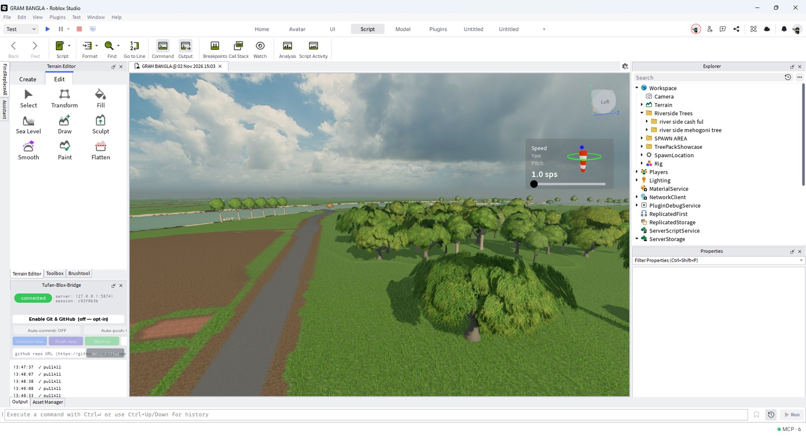

# Tufan-Blox-Bridge: Roblox Studio MCP Server and Plugin

[](https://www.npmjs.com/package/tufan-blox-bridge) [](LICENSE) [](https://github.com/drgost1/Tufan-Blox-Bridge/releases/latest)

**A free Roblox Studio MCP server and plugin that works as an add-on to Roblox's built-in Studio MCP.** Connect Claude Code, Cursor or any MCP client to Roblox Studio and let your AI build, audit and version your game: 85 tools for Luau scripts, instances and properties, plus two-way file sync, git history, snapshots, a backdoor scanner, Luau linting and AI 3D-asset generation.

Keep the built-in server for play tests and screenshots. Add Tufan for everything around them.

**[Website and overview](https://www.tufanstudio.net/roblox-studio-mcp)** · **[npm](https://www.npmjs.com/package/tufan-blox-bridge)** · **[Latest release](https://github.com/drgost1/Tufan-Blox-Bridge/releases/latest)**



---

## Quick install: connect Claude Code or Cursor to Roblox Studio

You need [Node.js 18 or newer](https://nodejs.org).

### Easiest: paste this into your AI agent

Open Claude Code, Cursor or another AI agent in your Roblox project folder and paste:

```text
Set up Tufan-Blox-Bridge, a Roblox Studio MCP server and plugin, for this project.

1. Run `npx -y tufan-blox-bridge@latest setup` in this folder. It installs the server and the Studio plugin, and registers with Claude Code or Cursor.
2. If it says nothing was registered, add the config it prints to your MCP settings, keeping any servers already there.
3. Don't ask me for API keys. They're optional.
4. Tell me what it did and the next steps it printed.
```

### Or run one command

```bash
npx -y tufan-blox-bridge@latest setup
```

Then restart Roblox Studio and your AI client, and open the **Tufan Studio** toolbar button. A green pill means it's connected.

### Or set it up by hand

**1 — One-line installer** (run from your Roblox project folder). It checks Node ≥ 18, installs the MCP server globally (`npm i -g tufan-blox-bridge`), drops the Studio plugin into your Plugins folder (`tufan-blox-bridge install-plugin`), and auto-registers with Claude Code when the `claude` CLI is on PATH:

```powershell
# Windows (PowerShell)
iwr https://raw.githubusercontent.com/drgost1/Tufan-Blox-Bridge/main/install.ps1 | iex
```
```bash
# macOS / Linux
curl -fsSL https://raw.githubusercontent.com/drgost1/Tufan-Blox-Bridge/main/install.sh | bash
```

**2 — Point your AI client at the server** (skip if the installer registered it; use **forward slashes** in the path):

```
claude mcp add tufan --env TUFAN_PROJECT=C:/path/to/your/project -- tufan-blox-bridge
```

For Cursor / Claude Desktop / any MCP client:

```json
{
  "mcpServers": {
    "tufan": {
      "command": "tufan-blox-bridge",
      "env": { "TUFAN_PROJECT": "C:/path/to/your/project" }
    }
  }
}
```

Optional env: `TUFAN_OPENCLOUD_KEY` (Open Cloud: `datastore`, `cloud_luau`, `get_server_logs`, `get_server_history`), `TUFAN_MESHY_KEY` (AI 3D generation).

**3 — Restart Studio and your AI client.** A **Tufan Studio** toolbar button appears — open its widget; the pill turns green when connected.

That's it. Your AI can now drive Studio, your scripts mirror to disk, and `scan_backdoors` is ready.

> **`tufan` times out / won't connect?** Run `claude mcp get tufan` and confirm the command is `tufan-blox-bridge` (global install) or `npx -y tufan-blox-bridge`. If an argument got dropped, `claude mcp remove tufan`, then re-run the add. The installer auto-verifies this.

### Other install methods
- **No install:** `npx -y tufan-blox-bridge` or `bunx tufan-blox-bridge`.
- **Global:** `npm i -g tufan-blox-bridge` → command `tufan-blox-bridge`.
- **Plugin:** `tufan-blox-bridge install-plugin` (copies the bundled `.rbxm` into your Plugins folder), or manually download `TufanBloxBridge.rbxm` from [Releases](https://github.com/drgost1/Tufan-Blox-Bridge/releases) (or `pwsh scripts/build-plugin.ps1 -Install`).

---

## Why add Tufan when Roblox Studio already has an MCP server?

Roblox's built-in Studio MCP is excellent at **running and seeing** your game. Tufan is the add-on for **building it safely, keeping it versioned and keeping it clean**. Install both: they cover different jobs, and Tufan tells your AI which one to use.

| You want to... | Built-in Studio MCP | Tufan add-on |
|---|---|---|
| Play test with a real character, keyboard and mouse | ✅ Use this | ➖ Left to the built-in |
| Take a screenshot of the viewport | ✅ Use this | ➖ Left to the built-in |
| Debug inside a running game | ✅ Use this | ➖ Warns the AI and points it there |
| Generate meshes, materials and scenes with Roblox AI | ✅ Use this | ➖ Has its own Meshy + Blender route |
| Checkpoint a subtree and restore it after a bad AI edit | ➖ | ✅ `snapshot` / `restore` |
| Keep scripts on disk with two-way sync | ➖ | ✅ Automatic mirror |
| Commit, diff and recover deleted scripts with git | ➖ | ✅ 12 `git_*` tools |
| Scan free models for backdoors | ➖ | ✅ `scan_backdoors` |
| Lint, type-check and format Luau | ➖ | ✅ Selene, luau-lsp, StyLua |
| Scan a place for performance and responsive UI problems | MicroProfiler analysis | ✅ `scan_perf`, `scan_responsive`, `project_health` |
| Build many objects in one call | By writing Luau yourself | ✅ Ready-made `batch`, `create_tree`, `mass_edit` |
| Read and edit live DataStores | ➖ | ✅ `datastore` (Open Cloud) |
| Upload local files | Images | ✅ `import_file`: models, audio, images (Open Cloud) |
| Keep notes on your project between AI sessions | Skills | ✅ `project_context`, per place |
| Let an AI explore with zero risk of changes | ➖ | ✅ `TUFAN_READONLY=1` |

### Six reasons to install it as an add-on

1. **AI edits become reversible.** Snapshots, git history and `git_recover` give you a way back that outlives Studio's undo stack.
2. **It's quick on every call.** In our benchmark, running the same Luau took 17 ms through Tufan and 67 ms through the built-in server (median of 25 calls, measured November 2026 on one Windows PC; your numbers will vary). Roblox allows a plugin about 500 HTTP requests a minute, roughly 240 Tufan calls, so big jobs should use `batch`; past that, calls wait rather than fail.
3. **Free models stop being a blind risk.** `scan_backdoors` checks scripts, attributes and values for hidden `require` payloads, obfuscation and webhooks.
4. **Your code lives where your tools do.** Scripts mirror to disk, so VS Code, Selene, luau-lsp and git all work on real files.
5. **Big builds stay manageable.** Thousands of changes go through in a single call, without your AI writing and debugging a Luau script for each job.
6. **The two servers cooperate.** Tufan tells your AI at connect to use the built-in server for screenshots, play tests and live debugging, and it flags any result that used the edit copy while a Play session is running.

Comparison based on each server's published tool list as of November 2026. Roblox updates its server often, so check its tool list for changes.

## How the Roblox Studio plugin and MCP server fit together

Two parts over a local HTTP bridge (`127.0.0.1:58741`):

- **MCP server** (`npx -y tufan-blox-bridge`) — what your AI client connects to. Exposes the 85 tools.
- **Studio plugin** (`TufanBloxBridge.rbxm`) — the in-Studio agent that executes commands and mirrors your scripts.

The AI calls a tool → the server queues a command → the plugin's long-poll picks it up → executes in Studio → returns the result. The server also handles file sync and git on your machine.

## Roblox Studio AI features

- 🛠 **Full Studio control** — 85 tools: scripts (line-level edits + atomic multi-hunk `patch_script`), instances (incl. whole-tree creation in one call), properties/attributes with full round-trip serialization (particle curves, gradients, fonts, springs), tags, tree inspection (`describe` = an instance's entire context in one call), Luau execution, output logs + a live error feed.
- 🔄 **Two-way file sync** — open a place and its script tree mirrors to disk; edit a file → Studio updates, edit in Studio → the file updates.
- 🌿 **Opt-in per-place git** — off by default (no `.git`, no headache). Turn it on in the widget and each place becomes its own repo with Commit / Push / Backup / Setup-GitHub buttons + auto-commit/push toggles. Your choice persists across restarts.
- 🛡 **Backdoor scanner** — `scan_backdoors` finds require-of-Value, loadstring+HttpGet, exploit APIs, Discord webhooks, obfuscation, and hidden binary payloads; `list_studio_plugins` surfaces the remote-code-plugin vector.
- ⏪ **Snapshots** — `snapshot` checkpoints any subtree before risky changes; `restore` brings it back exactly. A real undo that survives across the AI boundary.
- ⚡ **Batch ops** — `batch` runs dozens of mixed operations in one round-trip and one undo entry; 40 creates = 1 call, not 40.
- 📱 **Responsive UI engine** — `make_responsive` converts a UI subtree Offset→Scale with a validated formula (skips draggables, `dryRun` previews); `scan_responsive` audits tree **and** scripts for resolution breakage and sub-44px tap targets.
- 🩺 **One-look audits** — `project_health` (full place census in one traversal), `scan_perf` (ranked frame-killer fix list), `find_duplicates` (copy-pasted script clusters).
- 🧹 **Luau quality gate** — `format_scripts` (StyLua), `lint_scripts` (Selene: unused vars, shadowing, deprecated APIs, footguns), `typecheck` (luau-lsp: type errors, undefined globals, bad require paths — before the code runs), and `export_sourcemap` (Rojo-style sourcemap so luau-lsp resolves `require`s + gives IntelliSense) run the standard toolchain over your synced script mirror — host-side, no Studio round-trip.
- 🗄 **Live save data** — `datastore` reads and (gated) edits your PUBLISHED game's DataStores via Open Cloud — standard + ordered: list stores/keys, get/set/delete/increment. Read-first; writes need `confirm` and warn about the ProfileStore session-lock. No Studio runtime needed.
- ☁️ **Run code in production** — `cloud_luau` executes server-side Luau against your published game via the Open Cloud Luau Execution API (ephemeral server, real server context, `require` works) and returns the script's return values + print logs — verify behavior against prod without joining. Gated as a write tool; DataStore/HttpService side effects are real.
- 📈 **Production server observability** — `get_server_logs` reads per-server errors/warnings with full stack traces from your LIVE game (Open Cloud Server Management), and `get_server_history` lists 30 days of terminated/crashed/OOM servers with status, uptime and last-known memory/fps — then drill into any server's logs, even after it shut down.
- 📥 **Local file import** — `import_file` uploads `.rbxm`/`.fbx`/`.glb`/audio/images from your disk to your own Roblox account (Open Cloud) and drops them straight into the place — Models insert, audio becomes a `Sound`, images a `Decal`. Your own uploads always pass the LoadAsset ownership wall.
- 🧊 **AI 3D-asset generation** — `generate_asset` turns a text prompt (or image) into a game-ready prop in your open place: Meshy AI generates it, headless Blender lints + auto-fixes it against Roblox limits (≤20k tris, ≤1024px textures — Roblox silently mangles violations otherwise), Open Cloud uploads it, it inserts as a Model, and a **post-insert finishing pass** makes it actually game-ready: anchored, scaled to a stud height, semantic part names (no leaked "Cube"/"Cylinder"), flat material colors recovered (Roblox drops them on import), CollisionFidelity set, traceability attributes stamped, placed flush on the ground — one undo step. `previewFirst: true` shows you a **rendered thumbnail of the geometry preview before the texture spend**. Raw stages exposed too: `meshy_generate`/`meshy_task` (generation, remesh, credit balance) and `blender_run`/`blender_process` (headless Blender: lint, decimate, split-by-material, chunk oversized meshes, Cell-Fracture destructibles, convert, texture downscale, thumbnail render — or any custom bpy script). Credit-spend confirm gate built in.
- 🔐 **Your keys never leave your machine** — `TUFAN_MESHY_KEY` / `TUFAN_OPENCLOUD_KEY` live only in your local MCP server env, are scrubbed from every error message, and are never written to any file, repo, or log by the bridge. Each user brings their own keys.
- 🧭 **Spatial awareness** — the AI relates what it *sees* to coordinates: `scene_state` grounds a screenshot (every visible object's world **and** on-screen pixel coords via projection), `pick` raycasts a screen point → world hit + surface normal (identify / trace), `place_on` computes and applies a *flush* placement (bounding-box offset, optional align-to-surface + grid snap), `objects_in_region` queries an area.
- 👥 **Concurrent multi-session** — run several Claude/Cursor sessions on the same Studio at once; one owns the plugin, the rest proxy through it, all commands serialized → no collisions.
- 🧠 **Per-project AI memory** — `project_context` is a persistent markdown blob per place that the AI reads at session start (architecture, gotchas, false-bug traps) and updates as it learns — fewer tokens wasted re-discovering the project, fewer wrong conclusions.
- 🔒 **Read-only / safe mode** — `TUFAN_READONLY=1` hides the 36 write tools; mixed tools (`script_source`, `tag`, `git_branch`, `git_remote`) stay readable with writes blocked. Zero-risk AI exploration.
- 🎚 **Lean core toolset** — `TUFAN_TOOLSET=core` exposes only the 26 everyday tools (the power suites stay one env-var away) for smaller tool menus and sharper AI focus.
- 👁 **Seeing the game — by design, not ours** — screenshots come from the official Studio MCP's `screen_capture`, a real viewport render even when Studio is behind other windows. The server tells the AI this at connect, and flags any Tufan call that misses a running Play session. `get_asset_thumbnail` shows any catalog asset.
- ▶️ **Playtest — by design, not ours** — starting, driving and probing a play session belongs to **Roblox's official Studio MCP** (real Play Solo with a character, keyboard/mouse input, character navigation). Tufan deliberately doesn't duplicate it: run the session there, and Tufan's `get_output_log` / `get_recent_errors` / official `screen_capture` still watch it live, with `is_running` telling you edit mode from a live sim.
- 🗺 **Multi-place** — `list_places`, `pull_place`, and `copy_script_across` to move a module straight from one open place into another.

## Roblox Studio MCP tools (85)

| Group | Tools |
|---|---|
| **Scripts** | `script_source` · `grep_scripts` · `edit_script_lines` · `patch_script` · `find_and_replace_in_scripts` · `find_duplicates` |
| **Instances** | `create_instance` · `delete_instance` · `clone_instance` · `move_instance` · `rename_instance` · `create_tree` · `history` |
| **Properties** | `get_properties` · `set_property` · `mass_edit` · `search_by_property` · `get_attributes` · `set_attribute` · `mass_set_attribute` |
| **Inspection** | `get_tree` · `get_descendants` · `search_objects` · `get_services` · `describe` |
| **Tags** | `tag` · `get_tagged` |
| **Selection** | `get_selection` · `set_selection` |
| **Luau / Batch** | `run_luau` · `batch` |
| **Logs** | `get_output_log` · `get_recent_errors` · `get_server_logs` · `get_server_history` |
| **Snapshots** | `snapshot` · `restore` · `list_snapshots` · `delete_snapshot` |
| **Responsive UI** | `make_responsive` · `scan_responsive` |
| **Audits** | `project_health` · `scan_perf` |
| **Code quality** | `format_scripts` · `lint_scripts` · `typecheck` · `export_sourcemap` |
| **Spatial** | `scene_state` · `pick` · `place_on` · `objects_in_region` |
| **Git** | `git_status` · `git_log` · `git_diff` · `git_show` · `git_commit` · `git_push` · `git_pull` · `git_restore` · `git_revert` · `git_recover` · `git_branch` · `git_remote` |
| **Assets** | `search_assets` · `get_asset_details` · `get_asset_thumbnail` · `search_materials` · `insert_asset` · `import_file` |
| **Asset pipeline** | `generate_asset` · `meshy_generate` · `meshy_task` · `blender_run` · `blender_process` |
| **Open Cloud** | `datastore` · `cloud_luau` |
| **Security** | `scan_backdoors` · `list_studio_plugins` |
| **HTTP** | `http_get` |
| **Multi-place** | `list_places` · `pull_place` · `copy_script_across` |
| **Meta** | `ping` · `is_running` · `project_context` |

In read-only mode (`TUFAN_READONLY=1`) the 36 write tools are hidden (including `generate_asset`, `meshy_generate` — spends money —, `blender_run` — native host execution — and `cloud_luau` — runs code in production) and the mixed read/write tools (`script_source`, `tag`, `git_branch`, `git_remote`, `format_scripts`) stay visible with their write paths blocked (`datastore`'s write actions are also gated) — 50 inspection tools remain. With `TUFAN_TOOLSET=core` only the 27 everyday tools are exposed; both gates compose.

## How it works

- **Auto-mirror on connect** — opening a published place pulls its script tree to `<project>/projects/<Experience>_<universeId>/<Place>_<placeId>/`.
- **Two-way sync** — file edits push to Studio; Studio edits write to disk. A loop-guard prevents echo.
- **Git (opt-in)** — enable it in the widget; each place folder becomes its own repo. Off by default = plain files, no `.git`. A re-pull auto-snapshots first, so it never overwrites uncommitted work. `git_recover` brings back a deleted file from history.
- **HTTP limit** — Roblox allows a plugin about 500 HTTP requests a minute, roughly 240 Tufan calls. Past that, calls wait for the budget to refill (up to about a minute) rather than fail, so use `batch`, `create_tree` or `mass_edit` for big jobs.
- **Concurrent sessions** — the first server owns port 58741 + the plugin; others run as proxies that forward to it. The owner serializes every command through one plugin queue, so multiple sessions never collide. If the owner closes, a proxy promotes automatically.
- **Disconnect lock** — when the plugin goes offline the mirror is set read-only (copy-only) until it reconnects.

## Config (env)

| Variable | Effect |
|---|---|
| `TUFAN_PROJECT` | Project root for sync/git (use forward slashes). Defaults to cwd. |
| `TUFAN_READONLY=1` | Safe/inspector mode — write tools hidden, `script_source`/`tag` readable but write-blocked. |
| `TUFAN_TOOLSET=core` | Lean mode — expose only the 26 everyday core tools (default `full` = all 85). |
| `TUFAN_AUTOCOMMIT=1` | Auto-commit each Studio→file edit (also toggle-able in the widget). |
| `TUFAN_AUTOPUSH=1` | Also push after each commit. |
| `TUFAN_PROJECTS_DIR` | Base dir override for auto-registered projects. |
| `TUFAN_OPENCLOUD_KEY` | Open Cloud API key for `import_file` / `generate_asset` (assets Read+Write scopes, [create one here](https://create.roblox.com/dashboard/credentials)). |
| `TUFAN_CREATOR_ID` / `TUFAN_GROUP_ID` | Upload owner override for `import_file` / `generate_asset` (defaults to the logged-in Studio user). |
| `TUFAN_MESHY_KEY` | Meshy AI API key for `meshy_generate` / `meshy_task` / `generate_asset` ([create one here](https://www.meshy.ai/settings/api) — needs a paid Meshy plan). |
| `TUFAN_MESHY_AUTOCONFIRM=1` | Skip the per-call Meshy credit-spend confirmation gate. |
| `TUFAN_BLENDER_PATH` | Path to `blender.exe` for the Blender tools (default: auto-detect newest install, then PATH). |
| `TUFAN_ASSET_DIR` | Where generated assets download (default `~/.tufan-blox-bridge/assets/`). |

---

## Potential capability (roadmap)

Where this can go — honest about what's built vs. next:

- **Playtest automation — intentionally out of scope.** Tufan shipped plugin-side Run-mode control (`playtest`, `playtest_probe`, `playtest_input`) through v0.13; **removed in v0.14**. A plugin can only drive *Run* mode (server + physics, no player character) — Roblox's official Studio MCP drives real Play Solo with a character, keyboard/mouse and navigation, so duplicating a weaker version was net-negative. Run the session there; Tufan's log feed, screenshots and `is_running` still observe it.
- **Non-script instance mirroring** — models/parts as files on disk (geometry currently stays in Studio by reference, a plugin-API limit).
- **More Power Tools** — `scan_deprecated` (flag deprecated API usage across all scripts).
- **Asset pipeline, next steps** — mesh generation (v0.11) + real-world finishing/preview (v0.12) shipped. Still ahead: inventory-insert for unowned assets, Meshy auto-rigging/animation passthrough, bulk procedural kits via Blender geometry nodes, Roblox-privileged material generation (pairs with the official MCP).
- **Shared off-machine backup** — push every place mirror to a configured GitHub org with one click.

Issues + status tracked in [`ISSUES.md`](ISSUES.md). Contributions welcome.

## Repo

```
server/   TypeScript MCP server (published as npm `tufan-blox-bridge`)
plugin/   Luau Studio plugin (built to TufanBloxBridge.rbxm)
scripts/  build-plugin.ps1
docs/     launch notes, market comparison
```

## Roblox MCP FAQ

**What is Tufan-Blox-Bridge?**
A free, open-source Roblox Studio MCP server and Studio plugin. It lets AI coding tools such as Claude Code and Cursor edit scripts, build instances, audit and back up your game inside Roblox Studio.

**Does it replace Roblox's built-in Studio MCP?**
No. It's an add-on. Keep the built-in server for play tests, screenshots and live debugging, and use Tufan for editing, safety, versioning and audits.

**Does it work without the built-in server?**
Yes, for everything that happens in edit mode. You won't have screenshots or play testing, because Tufan leaves those to the built-in server.

**Which AI clients does it work with?**
Any MCP client over stdio, including Claude Code, Claude Desktop and Cursor.

**Do I need the Studio plugin as well as the npm package?**
Yes. The npm package is the MCP server your AI talks to, and the plugin carries out the commands inside Studio. The one-line installer sets up both.

**Is it free?**
Yes, MIT licensed. Only the optional Meshy AI features need a paid Meshy plan, and you bring your own keys.

**Is it safe to use on a real game?**
You choose how much it can do. Read-only mode hides every write tool, snapshots protect risky edits, and tools that touch your published game ask for a separate Open Cloud key. Your keys stay on your machine.

## License

MIT © Tufan Studio.
